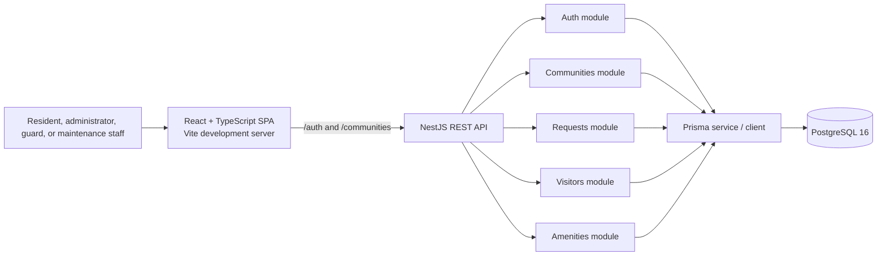

# CommunityOS system architecture

## Architectural style

CommunityOS is a modular monolith: one React browser application talks to one
NestJS REST API, which persists its state in PostgreSQL through Prisma. The
backend is divided into domain modules so that features remain separated
without the operational overhead of distributed services.

This is a practical fit for the current product and development stage:
authentication, authorization, validation, and database transactions share
one clear boundary, while feature modules can evolve independently. There is
no message broker, microservice mesh, or separate billing service.

## Context and container view

In local development, Vite proxies `/auth` and `/communities` requests to
`http://localhost:3000`. The PostgreSQL development container maps host port
`5433` to container port `5432`. The browser obtains short-lived access tokens
in memory and sends them as bearer tokens on protected API requests. The
longer-lived session credential is an HttpOnly cookie scoped to `/auth`.

## Backend module boundaries

| Module | Responsibility |
| --- | --- |
| `AuthModule` | Registration, login, access tokens, refresh sessions, logout, and JWT guard |
| `CommunitiesModule` | Community membership, roles, blocks, units, invitations, and security-team administration |
| `RequestsModule` | Service-request submission, role-filtered listing, status transitions, and history |
| `VisitorsModule` | Apartment-linked visitor passes and security check-in/out |
| `AmenitiesModule` | Amenity catalog, availability, reservations, conflict protection, and cancellation |
| `PrismaModule` | Shared database client lifecycle |

Each feature module owns its controller, business service, and request DTOs.
Nest's global `ValidationPipe` rejects unrecognized fields and transforms
validated request data. Controllers handle HTTP concerns; services enforce
membership, role, state-transition, and persistence rules.

## Typical request flow

1. The browser sends a request to the API with an access token.
2. `JwtAuthGuard` verifies the JWT and resolves the current user from
   PostgreSQL.
3. A feature service finds an active membership in the route's community.
4. The service applies role and ownership rules before reading or changing
   domain records.
5. Prisma executes parameterized database operations. Related state changes
   use transactions or conditional updates where atomicity matters.
6. The API returns a typed summary for the frontend to render.

Community roles are data attached to memberships, not trusted JWT claims.
Authorization decisions read current membership roles from the database.

## Data ownership and tenant isolation

The tenancy boundary is `Community`. Membership and role records associate a
user with a community, while block, apartment, request, visitor-pass, amenity,
and booking operations are addressed through a community ID. Composite
relations in PostgreSQL ensure that records such as a booking's amenity and
membership belong to the same community as the booking.

Application services additionally filter records by community and by the
current member when required. Examples: residents list only their own service
requests and visitor passes, while administrators and relevant staff can view
community-wide records.

## Important consistency controls

- Community setup and invitation redemption use database transactions to
  create related membership and role/unit relationships atomically.
- Request status updates use an allowed transition and conditional update so
  a concurrent stale update fails instead of overwriting a newer state.
- Visitor check-in/out uses conditional state updates and records the staff
  actor and timestamp.
- Amenity booking checks for interval overlap inside a transaction and takes a
  PostgreSQL advisory transaction lock for the amenity before inserting. This
  serializes simultaneous booking attempts for that amenity.

## Deployment shape

The local development environment uses Docker Compose for PostgreSQL. The API
and frontend are started separately. A production deployment is not yet
specified by this repository: hosting, TLS termination, backups, observability,
scaling, and managed secrets must be selected and configured before release.

## Architecture diagram caveats

The diagram shows the actual implemented API modules. Maintenance billing,
payments, and announcements do not have backend modules or tables and are not
included in the current interface.
